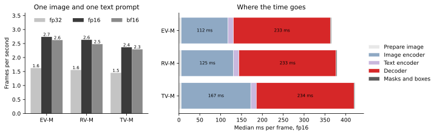
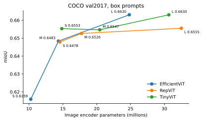
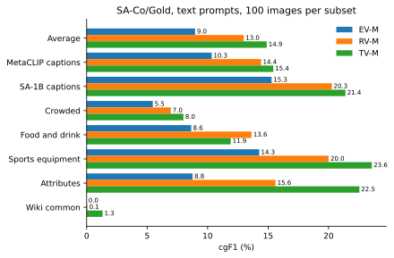
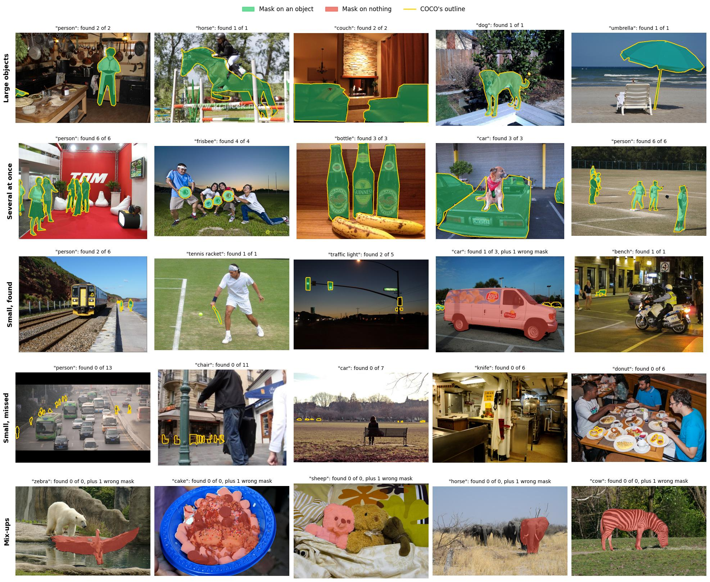

# EfficientSAM3 Jetson benchmark

How fast and how accurate [EfficientSAM3](https://github.com/SimonZeng7108/efficientsam3) is on an NVIDIA Jetson Orin Nano Super. The benchmarks run the published EfficientSAM3 code without changes.

This project isn't affiliated with the EfficientSAM3 authors, Meta, or NVIDIA.

## Models

EfficientSAM3 makes Meta's SAM 3 smaller by swapping its large encoders for small ones. Its checkpoints come from different training stages. Two of those stages are tested here. Stage 1 replaces only the image encoder. Stage 3 also replaces the text encoder and fine-tunes the result.

| Checkpoints | Image encoder | Text encoder | Tested here |
|---|---|---|---|
| Stage 1: ES-EV, ES-RV, ES-TV in sizes S, M, L | EfficientViT-B0 to B2, RepViT-M0.9 to M2.3, or TinyViT-5M to 21M | SAM 3's original | Box prompts |
| Stage 3: EV-M, RV-M, TV-M | EfficientViT-B1, RepViT-M1.1, or TinyViT-11M | MobileCLIP-S0 | Speed and text prompts |

## Results

All results were measured on a Jetson Orin Nano Super Developer Kit (8 GB) in MAXN_SUPER power mode. The software was JetPack 6 (L4T 36.4.4), PyTorch 2.8.0, and CUDA 12.6.

### Speed

How long each stage-3 model takes to find objects in one image from one text prompt. The left chart shows frames per second at each precision. The right chart shows how long each step takes in fp16.



[Full results](results/latency/pytorch/)

### Box-prompt accuracy

How closely each stage-1 model outlines the objects in COCO val2017 when given each object's bounding box. The score is mean IoU. Models with larger image encoders sit further to the right.



[Full results](results/accuracy/coco/)

### Text-prompt accuracy

How well each stage-3 model finds every object matching a short phrase like "gas grill". The test uses the first 100 images from each of the seven subsets in Meta's SA-Co/Gold benchmark. That is 7.6% of the benchmark's image-phrase pairs. The score is cgF1, the benchmark's official metric. It is high only when a model correctly says whether the phrase appears in the image and also outlines the matching objects well. 100 would be perfect.

The best model, TV-M, scores 14.9. Meta reports 54.1 for SAM 3 on the full benchmark. TV-M notices the phrase in about half of the images that contain it. It wrongly reports the phrase in 4% of the images that don't contain it.



[Full results](results/accuracy/saco-gold/)

### Examples

TV-M was asked to find each COCO category in 300 COCO images. It was also asked for two categories missing from each image. The top row shows the first images where it found every object. The bottom row shows its first miss, partial result, and false alarm.



It found 69% of large objects, 42% of medium objects, and 6% of small objects.

[Full results](results/examples/coco/)

## Running the benchmarks

You'll need JetPack 6 with CUDA 12.6, [uv](https://docs.astral.sh/uv/), up to 22 GB of disk space, and about 5 GB of free memory.

```bash
git clone --recurse-submodules https://github.com/tctibbs/efficientsam3-jetson-benchmark.git
cd efficientsam3-jetson-benchmark
uv sync
sudo nvpmodel -m 2 && sudo jetson_clocks  # MAXN_SUPER, clocks locked

uv run efficientsam3-jetson-benchmark download checkpoint efficientsam3_tinyvit efficient_sam3_tinyvit_m
uv run efficientsam3-jetson-benchmark download coco --first 5000
uv run efficientsam3-jetson-benchmark download saco-gold

uv run efficientsam3-jetson-benchmark latency pytorch --model efficientsam3_tinyvit --precision fp16
uv run efficientsam3-jetson-benchmark accuracy coco --checkpoint efficient_sam3_tinyvit_m --first 5000
uv run efficientsam3-jetson-benchmark accuracy saco-gold --model efficientsam3_tinyvit
uv run efficientsam3-jetson-benchmark examples coco
uv run efficientsam3-jetson-benchmark figures
```

Each run saves its results as a JSON file under `results/`. The `figures` command redraws the charts from these files. Downloaded checkpoints and annotations are checked against known SHA-256 hashes.

The EfficientSAM3 code is a git submodule pinned to commit `bd0936c`. Each result file records the code versions, software versions, Jetson settings, and checksums of the model and data used.

## Development

```bash
uv run pytest && uv run ruff check . && uv run ty check
```

## License

This repository is licensed under the [MIT License](LICENSE).

This project builds upon [EfficientSAM3](https://github.com/SimonZeng7108/efficientsam3), [SAM 3](https://github.com/facebookresearch/sam3), [COCO](https://cocodataset.org/), and [SA-Co/Gold](https://huggingface.co/datasets/facebook/SACo-Gold). Please refer to their respective licenses for usage terms.

## Acknowledgments

Special thanks to the amazing work by Chengxi Simon Zeng and the EfficientSAM3 team for making SAM 3 small enough to run on edge hardware. This benchmark relies on their released models and evaluation code. Thanks also to Meta for SAM 3 and the SA-Co/Gold benchmark. If you use EfficientSAM3 in your work, please cite the [EfficientSAM3 paper](https://arxiv.org/abs/2511.15833).
